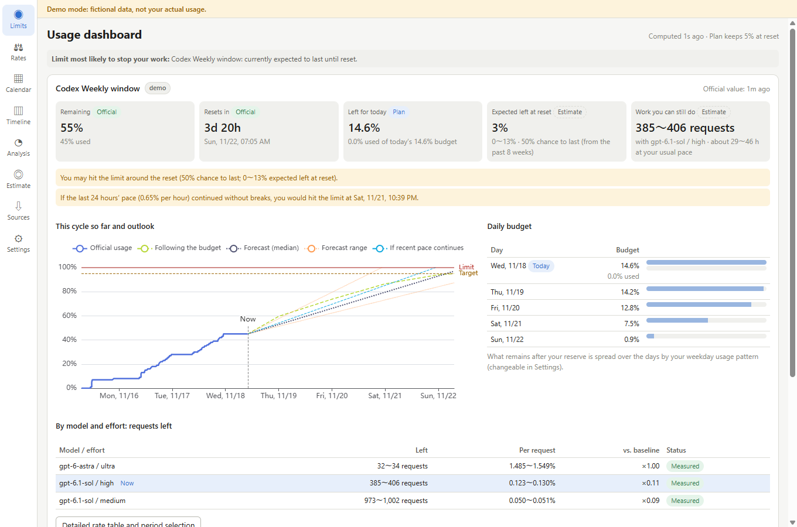
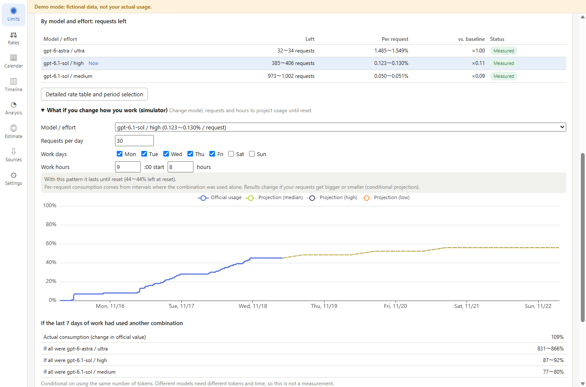
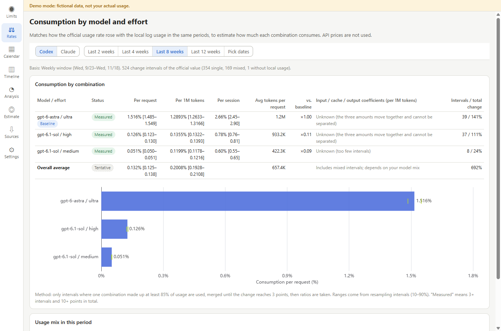
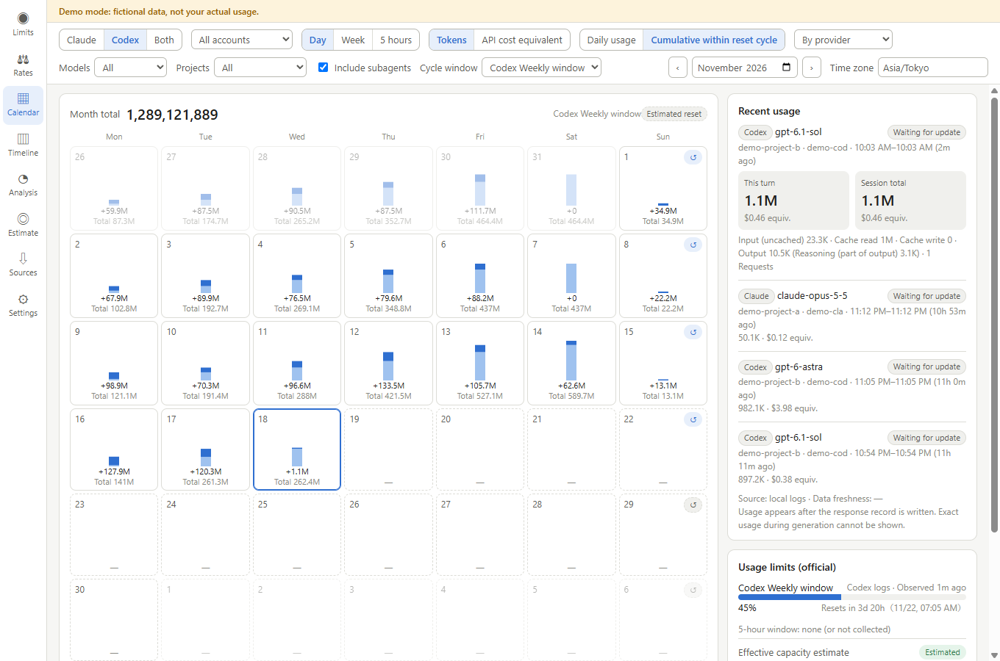
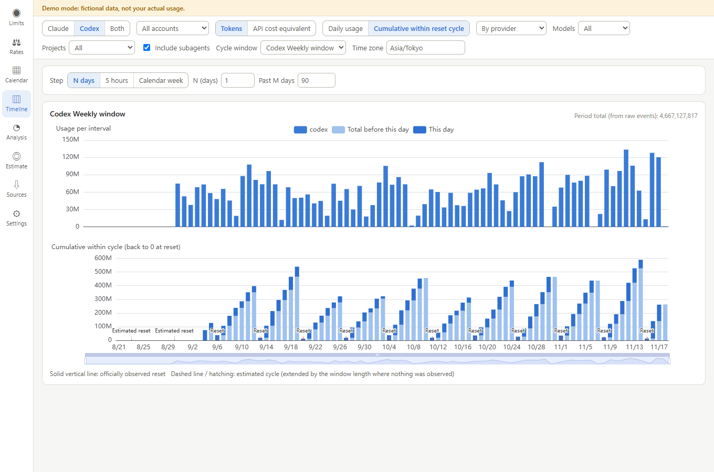
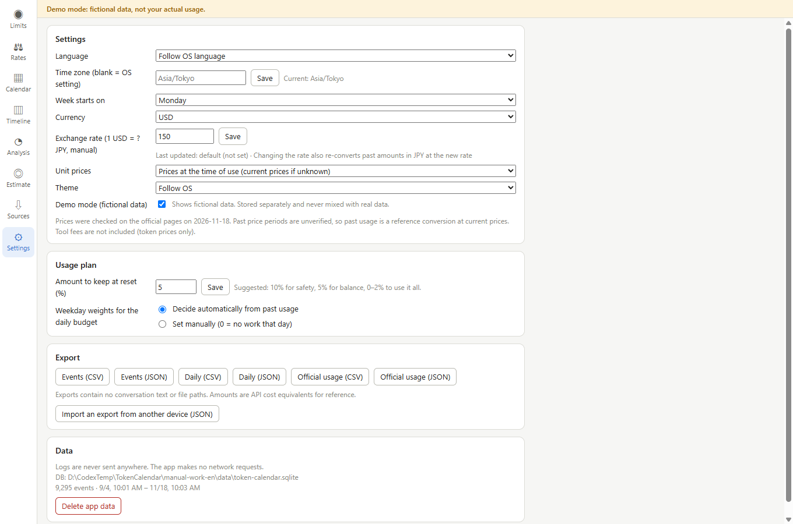

[日本語](../) · [GitHub repository](https://github.com/AloneCraft/TokenCalender)

Token Calendar is a desktop app that helps you **get the most out of your Claude Code and OpenAI Codex subscription limits**. From your local logs and the official usage rates, it answers:

- How much of the weekly limit is left?
- At the current pace, when will I hit the limit?
- How much can I still use today?
- How many more requests can I make with my current model and effort?
- Which model and effort use up the limit fastest?

> All screenshots in this guide use **demo mode (fictional data)**. They are not real usage.

## Contents

1. [Kinds of numbers](#kinds-of-numbers)
2. [Starting the app](#starting-the-app)
3. [Limits (home screen)](#limits-home-screen)
4. [Simulator](#simulator)
5. [Rates](#rates)
6. [Calendar, Timeline, Analysis, Estimate](#calendar-timeline-analysis-estimate)
7. [Settings](#settings)
8. [Getting Claude's official usage rate](#getting-claudes-official-usage-rate)
9. [FAQ](#faq)
10. [Limitations](#limitations)

## Kinds of numbers

The app never mixes numbers with different evidence. Use the tag next to each number:

| Tag | Meaning | Example |
| --- | --- | --- |
| **Official** | The usage rate published by Claude / Codex, with the time it was observed | 55% remaining |
| **Plan** | A budget computed from the official value and the reserve you choose | 14.6% left today |
| **Estimate** | A projection from your past usage, shown as a range | 385–406 requests |

The app also shows **token counts** from your logs and an **API cost equivalent** (what the same tokens would cost on the API). The API cost equivalent is for reference only. It is not a bill and is not used for the subscription limit calculations.

## Starting the app

### From source (Windows)

1. Install [Node.js](https://nodejs.org/) 22.15 or later.
2. Clone the repository:

   ```bash
   git clone https://github.com/AloneCraft/TokenCalender.git
   ```

3. Double-click `run.bat` in the folder. The first run takes a few minutes to install dependencies.

On macOS / Linux (not yet verified):

```bash
npm ci && node node_modules/electron/install.js && npm run start
```

### First import

On first start, the app reads all Claude Code and Codex logs on your computer and shows progress at the top. With about 27 GB of logs this takes about 3–4 minutes. Newest logs are read first, so recent usage appears quickly.

After that, the app remembers where it stopped reading, so it catches up in seconds. While you work, new log entries appear on screen within about a second.

Your original logs are only read, never changed or deleted, and never sent anywhere.

## Limits (home screen)



The bar at the top shows the **limit most likely to stop your work**. If there are several windows (for example a 5-hour and a weekly window), it shows the one expected to run out first.

### The five numbers

| Item | What it tells you |
| --- | --- |
| Remaining (Official) | The official remaining amount. The observation time is shown at the top right; after 30 minutes it is marked "Stale" |
| Resets in (Official) | Time and date of the next reset |
| Left for today (Plan) | Today's budget minus what you used today. Shown in red as "over" when you exceed it |
| Expected left at reset (Estimate) | What should be left at reset based on past weeks, and the chance it lasts until reset |
| Work you can still do (Estimate) | Requests left with your current model and effort, and hours of work at your usual pace |

### Advice lines

Below the numbers, short lines explain, with reasons:

- when you are expected to hit the limit
- when you would hit it if the last 24 hours' pace continued
- whether you exceeded today's budget
- how much per day (and how many requests) keeps you within the limit until reset
- whether there is room for higher effort on important work

### This cycle so far and outlook (chart)

| Line | Meaning |
| --- | --- |
| Official usage (thick line) | Official values so far this cycle |
| Following the budget (dashed) | Usage if you spend each day's budget exactly |
| Forecast (median) / Forecast range (dotted) | Projection from past weeks |
| If recent pace continues | The last 24 hours' pace without breaks |
| Limit / Target | 100% and 100% minus your reserve |

### Daily budget

What remains until reset, minus your reserve, spread over the days by your weekday usage pattern (changeable in Settings). Today's row also shows what you used today.

### Requests left by model and effort

How many requests you can still make with each combination. "Now" marks the combination you used most in the last 24 hours. "vs. baseline" compares per-request consumption with the baseline combination.

## Simulator

Open "What if you change how you work" at the bottom of the dashboard.



Change the model and effort, requests per day, work days and hours, and the projection until reset is recalculated immediately. If you would hit the limit, it shows when.

"If the last 7 days of work had used another combination" estimates consumption if the same number of tokens had been used with another combination. Different models need different numbers of tokens, so treat it as a rough guide.

## Rates

Select "Rates" on the left.



Pick a period (last 2/4/8/12 weeks or specific dates). The app matches how the official usage rate rose with your log usage over the same time, and estimates how much each combination consumes. **To estimate a specific period, choose it here.**

| Column | Meaning |
| --- | --- |
| Per request / per 1M tokens / per session | How many percent of the limit is used. Ranges in [ ] are 10–90% |
| Status | "Measured" means 3+ intervals and 10+ points in total; otherwise "Tentative" |
| Input / cache / output coefficients | Consumption by token type. "Unknown" if there are too few intervals or the three amounts always move together |
| Intervals / total change | Number of intervals used and the total rise in usage rate |

Only periods where one combination made up at least 85% of usage are used, because consumption cannot be separated when several models were mixed.

## Calendar, Timeline, Analysis, Estimate



- **Calendar**: daily usage as bars in a monthly calendar. "Cumulative within reset cycle" shows the running total that returns to 0 at each weekly reset. Select a day for details by hour and by model. The right column shows recent usage and the official limits.
- **Timeline**: days in one continuous row, in N-day, 5-hour or calendar-week steps. The top chart shows usage per interval; the bottom shows the cumulative total that returns to 0 at resets.



- **Analysis**: charts such as weekday × hour, cache read ratio and session size. Chart data can be exported as CSV / JSON.
- **Estimate**: official usage overlaid with log usage, and an estimate of the whole weekly window in tokens and API cost equivalent, with the intervals used and excluded (with reasons).

## Settings



| Item | Description |
| --- | --- |
| Language | "Follow OS language" (Japanese on a Japanese OS, otherwise English), Japanese, or English |
| Time zone / week start | Day boundaries and calendar layout |
| Currency / exchange rate | Display of the API cost equivalent (USD / JPY) |
| Amount to keep at reset | Suggested: 10% for safety, 5% for balance, 0–2% to use it all |
| Weekday weights for the daily budget | Automatic (from past usage) or manual (0 = no work that day) |
| Demo mode | Try the app with fictional data. Never mixed with real data |
| Export / import | Export events, daily totals and official usage as CSV / JSON; import exports from another device |
| Delete app data | Deletes only the app's own database, never your original logs |

## Getting Claude's official usage rate

Codex writes the official usage rate into its logs, so it is imported automatically. Claude Code does not, so use one of these:

1. **Status line link (optional)**: on the Sources page, review the change under "Claude status line link" and enable it. Only the usage rate and reset time are passed from the Claude Code status line. Your settings are backed up and restored when you remove the link.
2. **Manual entry**: on the Estimate page, enter the usage rate and reset time shown on the official page under "Manually recorded usage rates".

Until an official value exists, Claude's remaining amount and forecasts are shown as unknown. The app never invents numbers.

## FAQ

**Some numbers show "—" or "Unknown".**
There is no official usage rate yet, or not enough intervals for an estimate. Estimates appear as you keep using the tools.

**Is the API cost equivalent my bill?**
No. It is what the same tokens would cost at API prices, for reference.

**How accurate is the forecast?**
It assumes this week goes like your past weeks. With few past weeks, no probability is shown. Weeks whose records end early, and weeks that were already at the limit at the same point, are not used.

**What about usage on another computer or the web?**
It is not in this computer's logs, so it is not counted as usage. It does raise the official usage rate, so such periods are counted as "without local usage" and excluded from estimates.

**Where is my data stored?**
In an SQLite file in the app's data folder (`%APPDATA%\Token Calendar` on Windows). The location is shown under "Data" in Settings.

## Limitations

- How subscription consumption is calculated is not public. Rates and forecasts are estimates from how the official usage rate rises, not official limits.
- Rates for the 5-hour window only make sense if that window is recorded (some Codex plans do not report it).
- Notifications, plan comparison and after-the-fact evaluation of forecasts are not available yet.
- Verified on Windows 11 (x64). macOS and Linux builds are configured but not verified.
