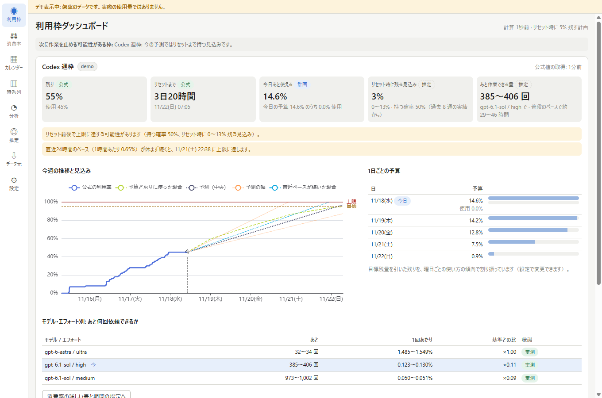
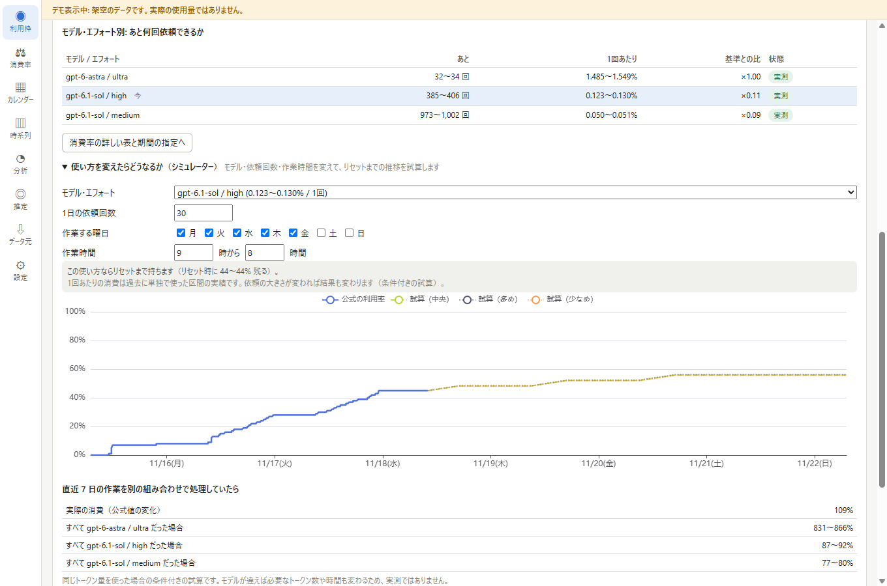
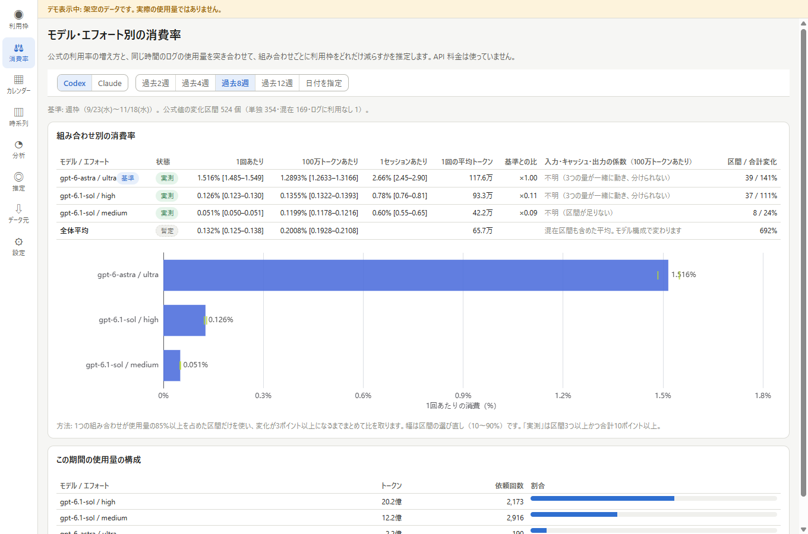
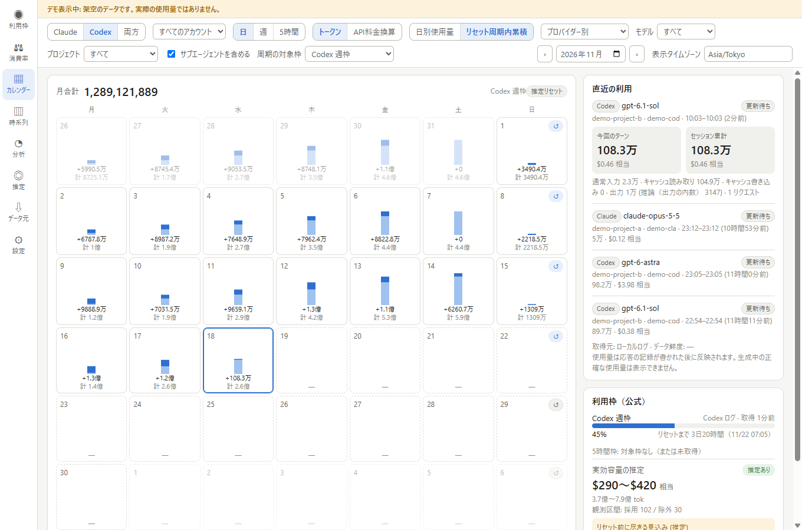
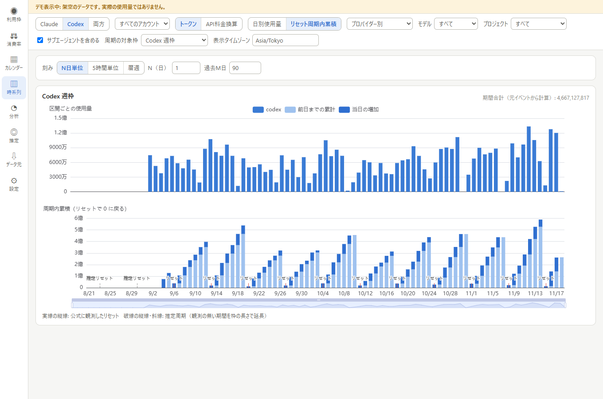
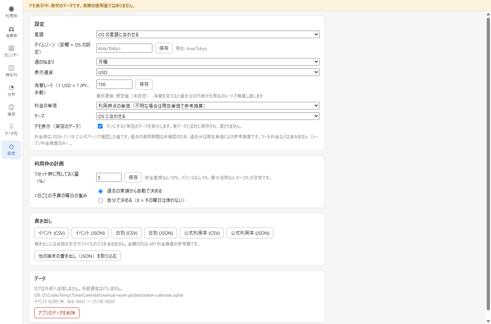

[English](en/) ・ [GitHub リポジトリ](https://github.com/AloneCraft/TokenCalender)

Token Calendar は、Claude Code と OpenAI Codex の**サブスクの利用枠を、上限ぎりぎりまで無駄なく使う**ためのデスクトップアプリです。手元のログと公式の利用率から、次のことに答えます。

- 週の利用枠は、あと何%残っているか
- 今のペースだと、いつ上限に達するか
- 今日はあと何%使ってよいか
- 今のモデル・エフォートで、あと何回依頼できるか
- どのモデル・エフォートが、利用枠を多く減らすか

> この説明書の画面写真は、すべて**デモ表示（架空のデータ）**です。実際の使用量ではありません。

## もくじ

1. [数値の種類の見分け方](#数値の種類の見分け方)
2. [起動のしかた](#起動のしかた)
3. [利用枠（最初の画面）](#利用枠最初の画面)
4. [シミュレーター](#シミュレーター)
5. [消費率](#消費率)
6. [カレンダー・時系列・分析・推定](#カレンダー時系列分析推定)
7. [設定](#設定)
8. [Claude の公式利用率を取り込むには](#claude-の公式利用率を取り込むには)
9. [よくある質問](#よくある質問)
10. [できないこと・注意](#できないこと注意)

## 数値の種類の見分け方

アプリは、根拠の違う数値を混ぜずに表示します。数値の横の札で見分けてください。

| 札 | 意味 | 例 |
| --- | --- | --- |
| **公式** | Claude / Codex が公表した利用率そのもの。取得した時刻も表示します | 残り 55% |
| **計画** | 公式の値と、あなたが決めた「リセット時に残す量」から計算した予算 | 今日あと 14.6% |
| **推定** | 過去の実績から計算した見込み。幅（〜）つきで表示します | あと 385〜406 回 |

ほかに、手元のログから数えた**トークン数**と、同じ量を API で使った場合の**API料金換算**があります。API料金換算は参考の金額で、請求額ではありません。サブスクの利用枠の計算にも使っていません。

## 起動のしかた

### ソースから起動する（Windows）

1. [Node.js](https://nodejs.org/)（22.15 以上）を入れます。
2. リポジトリを取得します。

   ```bash
   git clone https://github.com/AloneCraft/TokenCalender.git
   ```

3. フォルダーの中の `run.bat` をダブルクリックします。初回は部品の導入に数分かかります。

macOS・Linux では、次のコマンドで起動できます（未確認）。

```bash
npm ci && node node_modules/electron/install.js && npm run start
```

### 初回の取り込み

最初の起動では、パソコンにある Claude Code と Codex のログを全部読み込みます。画面の上に進み具合が出ます。ログが 27GB ほどある場合で約3〜4分かかります。新しいログから読むので、直近の利用はすぐ表示されます。

2回目以降は、読み終えた位置を覚えているので、数秒で最新になります。使っている間は、ログに書き込まれた内容が約1秒以内に画面へ反映されます。

元のログは読むだけで、変更・削除しません。ログを外部へ送信することもありません。

## 利用枠（最初の画面）



いちばん上の帯に、**次に作業を止める可能性がある枠**が出ます。枠が複数ある場合（例：5時間枠と週枠）は、先に上限に達しそうな方を表示します。

### 5つの数字

| 項目 | 見方 |
| --- | --- |
| 残り（公式） | 公式の利用率の残り。右上に取得した時刻が出ます。取得から30分を過ぎると「古い値」の札が付きます |
| リセットまで（公式） | 次のリセットまでの時間と日時 |
| 今日あと使える（計画） | 今日の予算から、今日すでに使った分を引いた量。使い過ぎると赤字で「超過」と出ます |
| リセット時に残る見込み（推定） | 過去の週の使い方から見た、リセットの時点で残る量と、リセットまで持つ確率 |
| あと作業できる量（推定） | 今のモデル・エフォートで、あと何回依頼できるか。普段のペースで何時間作業できるか |

### 下の文（提案）

数字の下に、根拠つきの一文が出ます。

- このままだと何日の何時ごろ上限に達するか
- 直近24時間のペースが続いた場合の上限の時刻
- 今日の予算を超えたかどうか
- リセットまで持たせるには、1日あたり何%（何回）までにすればよいか
- 余りそうなとき、重要な作業に高いエフォートを使う余地があるか

### 今週の推移と見込み（図）

| 線 | 意味 |
| --- | --- |
| 公式の利用率（太い実線） | 今週これまでの公式の値 |
| 予算どおりに使った場合（破線） | 1日ごとの予算を使い切った場合の推移 |
| 予測（中央）・予測の幅（点線） | 過去の週の実績から見た見込み |
| 直近ペースが続いた場合 | 直近24時間のペースが休まず続いた場合 |
| 上限・目標 | 100% と、「リセット時に残す量」を引いた目標 |

### 1日ごとの予算

リセットまでの残りから「リセット時に残す量」を引いて、各日に割り振った量です。曜日ごとの使い方の傾向で配分します（設定で変えられます）。今日の行には、今日使った量も並びます。

### モデル・エフォート別：あと何回依頼できるか

今の残りで、組み合わせごとにあと何回依頼できるかの表です。「今」の印が、直近24時間でいちばん使った組み合わせです。「基準との比」は、1回あたりの消費を基準の組み合わせと比べた倍率です。

## シミュレーター

ダッシュボードの下の「使い方を変えたらどうなるか」を開きます。



モデル・エフォート、1日の依頼回数、作業する曜日と時間を変えると、リセットまでの推移をすぐに計算し直します。上限に達する場合は、その日時を表示します。

その下の「直近7日の作業を別の組み合わせで処理していたら」は、同じトークン量を別の組み合わせで使った場合の消費の試算です。モデルが違えば必要なトークン数も変わるため、目安として見てください。

## 消費率

左の「消費率」を選びます。



期間（過去2・4・8・12週、または日付の指定）を選ぶと、その期間の公式の利用率の増え方と、同じ時間のログの使用量を突き合わせます。そして、組み合わせごとに利用枠をどれだけ減らすかを推定します。**特定の期間の推定は、ここで期間を選んで行います。**

| 列 | 意味 |
| --- | --- |
| 1回あたり / 100万トークンあたり / 1セッションあたり | 利用枠を何%減らすか。[ ] の中は幅（10〜90%） |
| 状態 | 「実測」は区間が3つ以上かつ合計10ポイント以上。足りなければ「暫定」 |
| 入力・キャッシュ・出力の係数 | トークンの種類ごとの消費。区間が足りないときや、3つの量がいつも一緒に動くときは「不明」 |
| 区間 / 合計変化 | 推定に使った区間の数と、その間の利用率の増え方の合計 |

推定には、1つの組み合わせだけを使っていた時間（使用量の85%以上）だけを使います。複数のモデルを混ぜて使った時間からは、組み合わせ別の消費を分けられないためです。

## カレンダー・時系列・分析・推定



- **カレンダー**：月のカレンダーに、日ごとの使用量を縦棒で表示します。「リセット周期内累積」に切り替えると、週のリセットで 0 に戻る累計を表示します。日付を選ぶと、時間帯別・モデル別の詳細が出ます。右側は「直近の利用」と「利用枠（公式）」です。
- **時系列**：日付を横一列に並べます。N日単位・5時間単位・暦週で、上は区間ごとの使用量、下はリセットで 0 に戻る累積です。



- **分析**：曜日×時間帯、キャッシュ読み取りの比率、セッションの大きさなどの図を選んで見られます。図のデータは CSV / JSON で書き出せます。
- **推定**：公式の利用率とログの使用量を重ねた図と、週枠全体がトークン・API料金換算で何に当たるかの推定です。採用・除外した区間を理由つきで表示します。

## 設定



| 項目 | 内容 |
| --- | --- |
| 言語 | 「OS の言語に合わせる」（日本語の OS なら日本語、それ以外は英語）・日本語・English |
| タイムゾーン・週の始まり | 日の区切りとカレンダーの並び |
| 表示通貨・為替レート | API料金換算の表示（ドル / 円） |
| リセット時に残しておく量 | 安全重視なら 10%、バランスなら 5%、最大活用なら 0〜2% が目安 |
| 1日ごとの予算の曜日の重み | 自動（過去の実績から）か、自分で決める（0 = その曜日は使わない） |
| デモ表示 | 架空のデータで画面を試せます。実データとは混ざりません |
| 書き出し・取り込み | イベント・日別・公式利用率を CSV / JSON で書き出し。別の端末の書き出しも取り込めます |
| アプリのデータを削除 | アプリが作った DB だけを消します。元のログは消しません |

## Claude の公式利用率を取り込むには

Codex は、ログに公式の利用率が記録されるので自動で取り込みます。Claude Code は、ログに利用率が記録されません。次のどちらかで取り込みます。

1. **ステータスライン連携（任意）**：データ元の画面の「Claude ステータスライン連携」で、変更内容を確認してから有効にします。Claude Code のステータスラインから、利用率とリセット時刻だけを受け取ります。元の設定はバックアップし、解除すると元に戻ります。
2. **手動記録**：推定の画面の「手動記録した利用率」に、公式画面に出ている利用率とリセット日時を入力します。

公式の値が無いあいだは、Claude の残りや予測は「不明」と表示します。架空の数値は出しません。

## よくある質問

**数値が「—」や「不明」になっている**
公式の利用率が無い、または推定に必要な区間が足りないためです。しばらく使うと、区間が増えて推定が出ます。

**API料金換算は請求額ですか**
いいえ。同じトークン量を API の単価で使った場合の参考額です。

**予測はどのくらい当たりますか**
過去の週の使い方が今週も続くと仮定した見込みです。過去の週の数が少ないときは、確率を出しません。記録が途中で終わった週や、同じ時点ですでに上限だった週は使いません。

**別のパソコンや Web で使った分はどうなりますか**
そのパソコンのログには残らないので、使用量には入りません。公式の利用率には反映されるため、「ログに利用なし」の区間として数え、推定には使いません。

**データはどこに保存されますか**
アプリのデータフォルダー（Windows では `%APPDATA%\Token Calendar`）の SQLite ファイルです。設定の「データ」に場所が出ます。

## できないこと・注意

- サブスクの消費の計算方法は公開されていません。消費率と予測は、公式の利用率の増え方から求めた推定です。公式の上限値ではありません。
- 5時間枠の消費率は、5時間枠の記録がある場合だけ意味があります（Codex のプランによっては記録されません）。
- 通知、プランの比較、予測が当たったかの事後評価は、まだありません。
- 動作を確かめたのは Windows 11（x64）です。macOS・Linux は設定だけ用意してあり、未確認です。

開発者向けの資料: [推定の方法](estimation.md) ・ [ログの形式](data-formats.md) ・ [対応環境](support-matrix.md) ・ [検証の記録](verification.md)
